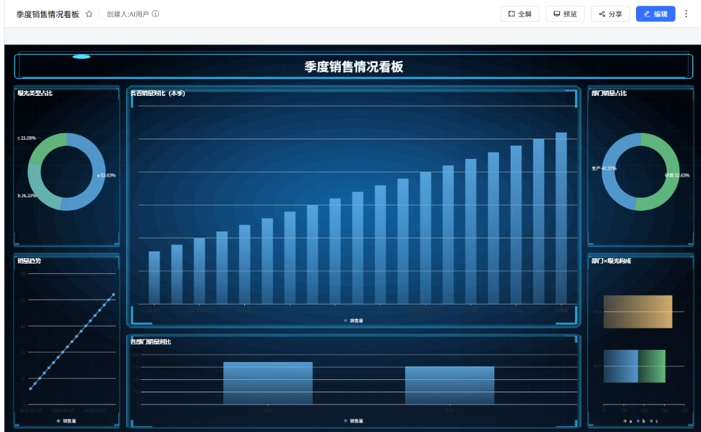
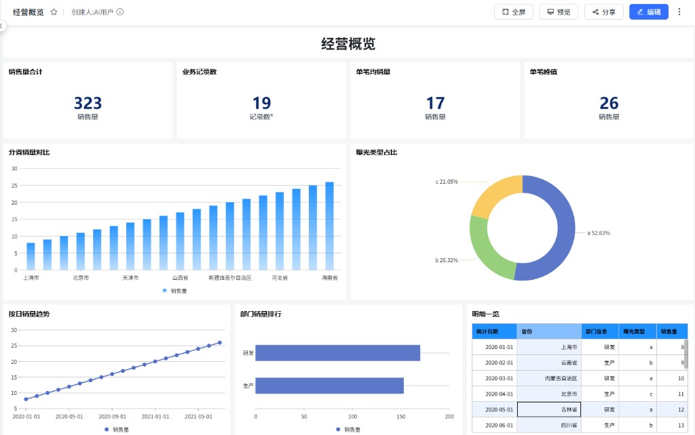

# DataEase V3 Skills（dev3-skills）

面向 **AI Agent** 的 DataEase 3.x 能力包：通过 **Python3 + API Key** 管理数据源、新建数据集、制作数据大屏（dataV）与仪表板（dashboard）。

可在 **WorkBuddy、Cursor、Codex、Claude Code** 等支持 Agent Skills / 自定义技能的工具中加载本目录后使用。Agent 入口为 [SKILL.md](SKILL.md)；字段与流程见 `references/`，命令示例见 `examples/`。

## 能力一览

| 能力 | 状态 | 说明 |
|------|------|------|
| 数据源 | 已实现 | 查询 / 新建 / 校验 / 更新 / 删除（内置类型） |
| 数据集 | 已实现 | 取表 → 字段 → 预览 → 保存；计算 / 分组 / 复制字段；维度 / 指标；编辑 / 删除（内置血缘分析与分级确认） |
| 数据大屏 dataV | 已实现 | 图表选型、像素排版、装饰/图片/视频、过滤与聚合、视觉构图规范、发布 |
| 仪表板 dashboard | 已实现 | 亮色主题、矩阵布局（72×36）、模板排版、过滤与聚合、发布 |
| 电子表格 spreadsheet | 已实现 | 新建多 Sheet 表格（主题预设/公式/富文本/样式/冻结/条件格式/数据验证/筛选/批注/斜线格/明细表/查询组件）；修改本任务所建；发布 |
| 数据故事 | 未实现 | — |
| 插件数据源新建/改配置 | 未实现 | 产品中可能可见；查询仍可用 |

## 数据大屏效果参考

按视觉构图规范生成的居中美化大屏示例（季度销售情况看板）：



提示词与 plan 见 [examples/datav_showcase_center_beautify.md](examples/datav_showcase_center_beautify.md)；构图规则见 [references/datav_visual.md](references/datav_visual.md)。

## 仪表板效果参考

亮色矩阵布局示例（经营概览：指标卡 + 柱/环/折线/条形 + 明细表）：



流程与 plan 见 [examples/dashboard.md](examples/dashboard.md)；说明见 [references/dashboard.md](references/dashboard.md)。

## 在 Agent 中使用

本 skill 为**连接制**：一切操作都基于用户提供的 DataEase V3 连接信息。

1. 将本目录（`dev3-skills/`）作为 Skill 安装或加入工具的 skills 路径（各产品名称可能为 Skill / Custom instruction / Agent skill）。  
2. Agent 的第一动作是确认连接：**本地没有配置时，会先向你索取 DataEase「部署地址 / Access Key / Secret Key」**，拿到并验证连通后才开始业务。  
3. Agent 先保存并验证连接（`scripts/de_setup.py save` → `check`），随后按 [SKILL.md](SKILL.md) 工作流调用 `scripts/` 下 CLI。

> 拿到并验证连接信息之前，Agent 不会讨论需求、也不会执行任何操作——缺少连接时其余步骤都没有意义。

```bash
cd scripts
python de_setup.py save --base-url https://your-de-host --access-key <AK> --secret-key <SK>
python de_setup.py check    # 验证连通性 + 自动发现五棵树的组织根 + 建议写入范围
```

连接信息优先从本地配置读取：默认 `~/.dataease-de3/config.json`（类 Unix 下收紧为 0600；Windows 下位于当前用户 home，依赖用户目录 ACL；可用 `DE_CONFIG_FILE` 指定），也支持环境变量 `DE_BASE_URL` / `DE_ACCESS_KEY` / `DE_SECRET_KEY` / `DE_ALLOWED_WRITE_SCOPE`（环境变量优先）。**密钥只存本地，请勿提交到仓库**。

适用工具示例（不限于）：WorkBuddy、Cursor、Codex、Claude Code。

## 目录结构

```
dev3-skills/
  README.md             # 本说明
  SKILL.md              # Agent 入口与强制规则
  assets/               # 文档效果参考图（非运行时生成物）
  references/           # 环境、数据源、数据集、大屏、仪表板、电子表格、视觉规范
  examples/             # 可复制 CLI 示例
  scripts/              # Python CLI
    requirements.txt
    de_setup.py         # 连接配置（连接制）：save / check / show
    de_client.py
    datasource.py
    dataset.py
    datav.py
    dashboard.py
    relation.py
    spreadsheet.py
```

## 环境要求

- **Python 3.9+**（系统 `python3` / `python`，或 Conda / Miniconda / Mamba 环境）  
- 依赖见 `scripts/requirements.txt`（`PyJWT`、`requests`、`pycryptodome`）  
- DataEase 3.x 与可用的 **API Key**  
- 建议业务角色账号（非 `admin`）；删改前备份  

### Python 环境：自动检测与安装（须向用户说明并确认）

Agent **首次执行本 skill 的脚本前**应自动检测本地环境，**不得静默安装**。

**检测顺序（找到即用）：**

1. 当前 shell 已激活的虚拟环境 / Conda 环境（`python` / `python3`，版本 ≥ 3.9）  
2. `python3`、`python`（Windows 上常见为 `py -3`）  
3. Conda：`conda info --envs` / `conda run -n <env>`；优先已有且含依赖的环境  

**依赖检查：** 在候选解释器上尝试 `import jwt, requests, Crypto`（或对照 `requirements.txt`）。

**若缺失解释器或依赖：**

1. 向用户说明将使用的命令（如 `pip install -r scripts/requirements.txt`，或 `conda create` / `conda install`）及影响范围  
2. **征得用户明确同意后再执行安装**  
3. 安装完成后复检版本与 import，再继续业务操作  

用户拒绝安装时：给出手工步骤并暂停，勿强行继续调用脚本。

## 配置与自检

**推荐方式（连接制，密钥只落本地）**：

```bash
cd scripts
# 仅在用户确认后安装：pip install -r requirements.txt
python de_setup.py save --base-url https://your-de-host --access-key <AK> --secret-key <SK>
python de_setup.py check
```

`check` 会验证连通性、显示账号，并自动列出五棵树的组织根 id 与建议写入范围（可直接 `save --write-scope ...` 保存）。

也可用环境变量（优先于本地配置）：

```bash
export DE_BASE_URL=https://your-de-host
export DE_ACCESS_KEY=your_access_key
export DE_SECRET_KEY=your_secret_key
# 推荐：允许写入的组织根/文件夹（逗号分隔；五棵树 id 通常不同）
export DE_ALLOWED_WRITE_SCOPE=<id1>,<id2>,<id3>,<id4>,<id5>
```

Windows PowerShell：

```powershell
cd scripts
$env:DE_BASE_URL="https://your-de-host"
$env:DE_ACCESS_KEY="..."
$env:DE_SECRET_KEY="..."
$env:DE_ALLOWED_WRITE_SCOPE="..."
```

自检：

```bash
python de_setup.py show     # 当前生效配置（密钥脱敏）
python datasource.py whoami
python datasource.py types
python datav.py catalog
python dashboard.py catalog
```

更多约定见 [references/common.md](references/common.md)。

## 文档索引

| 场景 | 文档 |
|------|------|
| 环境 / 认证 / 文件夹 / 风险话术 / Python 检测 | [references/common.md](references/common.md) |
| 数据源 | [references/datasource.md](references/datasource.md) · [examples/datasource.md](examples/datasource.md) |
| 数据集 | [references/dataset.md](references/dataset.md) · [examples/dataset.md](examples/dataset.md) |
| 数据大屏 | [references/datav.md](references/datav.md) · [examples/datav.md](examples/datav.md) |
| 大屏视觉 / 构图 | [references/datav_visual.md](references/datav_visual.md) · [examples/datav_showcase_center_beautify.md](examples/datav_showcase_center_beautify.md) |
| 仪表板 | [references/dashboard.md](references/dashboard.md) · [examples/dashboard.md](examples/dashboard.md) |
| 电子表格 | [references/spreadsheet.md](references/spreadsheet.md) · [references/spreadsheet_visual.md](references/spreadsheet_visual.md) · [examples/spreadsheet.md](examples/spreadsheet.md) |
| Agent 强制规则与工作流 | [SKILL.md](SKILL.md) |

## 使用约定（摘要）

1. **五棵独立资源树**：数据源、数据集、数据大屏、仪表板、电子表格的组织 / 文件夹 id 通常不同，用对应 CLI 的 `resolve-folder`，勿混用。  
2. **写入边界**：只在用户允许范围与 `DE_ALLOWED_WRITE_SCOPE` 内增删改。  
3. **删改须确认**：先备份与风险说明，用户同意后再执行。**数据源删除禁止自动执行**：须先列出其血缘引用，且用户完整输入口令「我确认删除此数据源，并已知风险、不会影响业务」方可删除。  
4. **数据集与可视化**：未确认不得随意复用或修改已有数据集；图表保存前须取数预览成功。**编辑/删除已有资源前强制血缘分析**：被仪表板/数据大屏引用时须用户输入「确认修改」方可继续。  
5. **电子表格**：仅可修改当前任务内创建的电子表格；不支持修改已存在的电子表格。  
6. **配置以 reference 为准**：不要传入未文档化的类型或字段。  
7. **Python 安装须确认**：自动检测可以，自动安装前必须解释并得到用户同意。

## License

随本仓库分发策略为准。请遵守目标 DataEase 实例的安全与合规要求；勿将 API Key、地址等密钥写入公开仓库。
